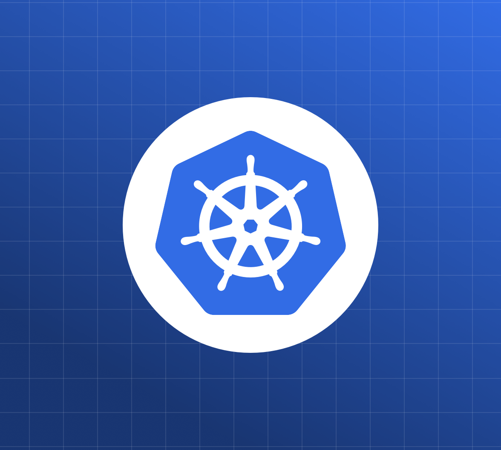

<div align="center">



# Lens Clone

**A pure-Rust Kubernetes GUI** — a lightweight, [Lens](https://k8slens.dev)-like desktop app.
No Electron, no webview, no bundled browser. Just a single native binary.

[](https://rustup.rs)
[](https://github.com/emilk/egui)
[](https://kube.rs)
[](#license)
[](#prerequisites)

</div>

---

## Overview

**Lens Clone** connects to the **current context of your kubeconfig** and delivers three signature
Lens features in a native, GPU-rendered window. The UI is [egui](https://github.com/emilk/egui)
(immediate mode); all Kubernetes work runs on a background [`tokio`](https://tokio.rs) runtime via
[`kube-rs`](https://kube.rs). The result is a single native binary of a few MB — instead of a
~150 MB Electron bundle.

> **Read-only for resources in v1** (no edit/apply/delete) — safe by default. Logs and shell are the
> only interactive paths.

## Features

- 📋 **Resource browser + cluster overview** — browse Pods / Deployments / Services / Nodes /
  ConfigMaps / Namespaces / Events, with a dashboard of node CPU/memory gauges and resource counts.
- 💻 **Pod shell** — an interactive terminal (`exec`) into a container.
- 📜 **Live pod logs** — follow/tail streaming, per-container, with filtering.
- ⚡ **Native & tiny** — no Electron/webview; a single GPU-rendered binary.
- 🔒 **Safe by default** — read-only resource access in v1.

## Table of Contents

- [Screenshots](#screenshots)
- [Prerequisites](#prerequisites)
- [Quick start](#quick-start)
- [Building a release](#building-a-release)
- [Usage](#usage)
- [Architecture](#architecture)
- [How this maps to Kubernetes Lens](#how-this-maps-to-kubernetes-lens)
- [Scope & non-goals (v1)](#scope--non-goals-v1)
- [License](#license)

## Screenshots

> _Add screenshots to `assets/` and reference them here, e.g.:_
>
> ```md
> 
> 
> ```

## Prerequisites

- **Rust** (stable) via [rustup](https://rustup.rs).
- A reachable cluster in your kubeconfig (`~/.kube/config` or `$KUBECONFIG`).
  Verify with `kubectl get nodes`.
- Platform build tools:
  | OS | Requirement |
  | --- | --- |
  | **Windows** | "Desktop development with C++" (MSVC Build Tools). WebView2 is **not** required. |
  | **macOS** | Xcode Command Line Tools (`xcode-select --install`). |
  | **Linux** | egui deps (`libgtk-3-dev`, `libxcb`/`libxkbcommon`, etc.). |
- Live metrics on the Overview require **metrics-server** in the cluster. If it's absent, the app
  still runs and shows capacity with a "metrics-server not installed" note.

## Quick start

```sh
git clone <your-repo-url> lens-clone
cd lens-clone
cargo run
```

The native window opens against your current kubeconfig context.

> On **Windows** this project builds with the **GNU toolchain** + mingw `gcc`
> (`rustup default stable-x86_64-pc-windows-gnu`) to avoid needing Visual Studio. On **macOS** use the
> normal default toolchain — no GNU/mingw needed.

### Renderer backend

Both renderers are compiled in and chosen at runtime: **glow** (OpenGL, default) and **wgpu**
(DX12/Vulkan, the fallback that fixes black windows on RDP/VMs). Override with the `LENS_RENDERER`
environment variable.

## Building a release

A release binary is produced per host OS — build the Windows app on Windows and the macOS app on a Mac.

<details>
<summary><b>Windows — portable exe / .msi</b></summary>

```powershell
cargo build --release
# -> target\release\lens-clone.exe
```

Optional `.msi` installer (one-time: `cargo install cargo-wix`):

```powershell
cargo wix --nocapture
```

</details>

<details>
<summary><b>macOS — .app / .dmg (must be built on a Mac)</b></summary>

```sh
# 1) Plain binary
cargo build --release
# -> target/release/lens-clone

# 2) A .app bundle (metadata is in [package.metadata.bundle] in Cargo.toml)
cargo install cargo-bundle          # one-time
cargo bundle --release
# -> target/release/bundle/osx/Lens Clone.app

# 3) Wrap the .app into a .dmg
hdiutil create -volname "Lens Clone" \
  -srcfolder "target/release/bundle/osx/Lens Clone.app" \
  -ov -format UDZO "Lens Clone.dmg"
```

Universal (Intel + Apple Silicon) binary, optional:

```sh
rustup target add x86_64-apple-darwin aarch64-apple-darwin
cargo build --release --target x86_64-apple-darwin
cargo build --release --target aarch64-apple-darwin
lipo -create -output lens-clone-universal \
  target/x86_64-apple-darwin/release/lens-clone \
  target/aarch64-apple-darwin/release/lens-clone
```

The build is unsigned; macOS Gatekeeper may require right-click → **Open** the first time (or
`xattr -dr com.apple.quarantine "Lens Clone.app"`).

</details>

## Usage

1. Launch; the top bar shows the connected context.
2. **Overview** tab: node CPU/memory gauges + cluster counts + recent warnings.
3. **Resources** tab (or click a kind in the left nav): browse a kind; filter by name; pick a namespace.
4. Click a row to open the detail drawer (raw YAML). For a **Pod**, use **Logs** or **Shell**.
5. Logs and shells open as tabs in the bottom dock; close them with the ✕.

## Architecture

```
  egui/eframe UI thread                     channels                 tokio worker (kube-rs)             Cluster
  Sidebar / Overview / Table   ──Command::ListResources,…──▶  Api::<K>::list()/get(), Metrics      ─▶ kube-apiserver
  Logs panel (scroll)          ◀──Event::LogChunk────────────  Api::log_stream(follow)              ─▶ .../pods/{p}/log
  Terminal widget           ◀─Event::ExecOut / Command::ExecIn,Resize─▶ Api::exec → AttachedProcess ─▶ .../pods/{p}/exec
```

| Path | Responsibility |
| --- | --- |
| `src/main.rs` | Boots the tokio runtime + eframe window. |
| `src/app.rs` | The eframe `App`: drains worker events each frame and lays out the panels. |
| `src/state.rs` / `src/types.rs` | UI state and the plain data types that cross the boundary. |
| `src/bridge.rs` | The `Command`/`Event` channel contract. |
| `src/kube/` | `client`, `resources`, `overview`, `logs`, `exec`, and the `worker` loop. |
| `src/ui/` | `sidebar`, `overview`, `resource_table`, `detail`, `logs_view`, `terminal`. |

## How this maps to Kubernetes Lens

Lens is an **Electron** app: a Node "main" process reads your kubeconfig and proxies to the cluster,
and a React/Chromium "renderer" draws the UI. (The original `lensapp/lens` went closed-source; the
live open-source lineage is **OpenLens** and the maintained fork **Freelens**.) This app delivers the
same *capabilities* natively:

| Lens mechanism | Here |
| --- | --- |
| Electron main process + `lens-k8s-proxy` reading kubeconfig | `kube::Client::try_default()` on a tokio worker |
| React/Chromium renderer | egui immediate-mode UI (native, GPU) |
| Resource lists via kube API watches | `Api::<K>::list()` (polling refresh in v1) |
| Overview gauges from metrics-server / Lens Metrics (Prometheus) | `metrics.k8s.io/v1beta1` + `Node.status.capacity` |
| Pod shell over the kube `exec` WebSocket + xterm.js | `Api::exec()` → `AttachedProcess` + an egui terminal widget |
| Pod logs via `.../pods/{p}/log?follow=true` | `Api::log_stream(LogParams { follow: true, .. })` |

## Scope & non-goals (v1)

- Read-only resource browsing (no edit/apply/delete).
- Single (current) kubeconfig context; multi-context switching is a future addition.
- Overview usage requires metrics-server; its absence is handled gracefully.
- No code-signing / notarization (local unsigned builds).

## License

[MIT](LICENSE).
